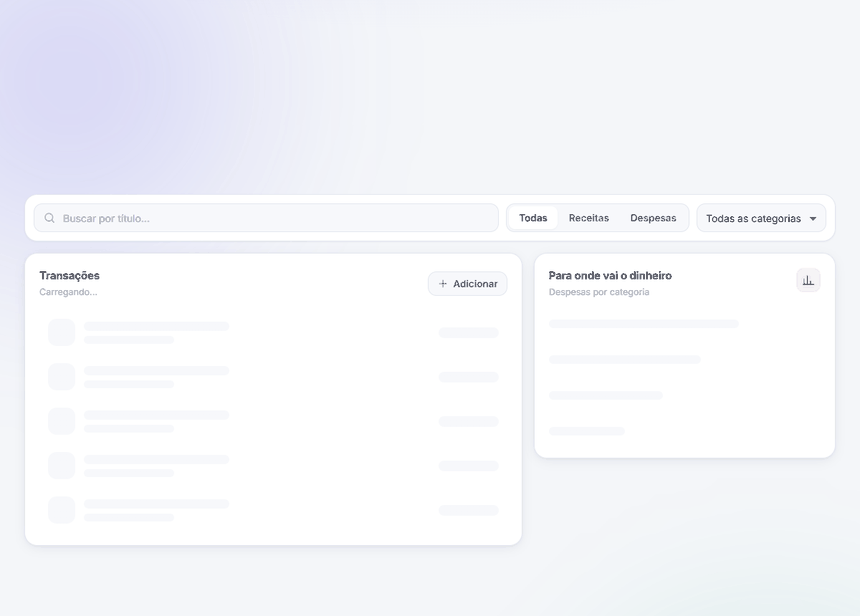
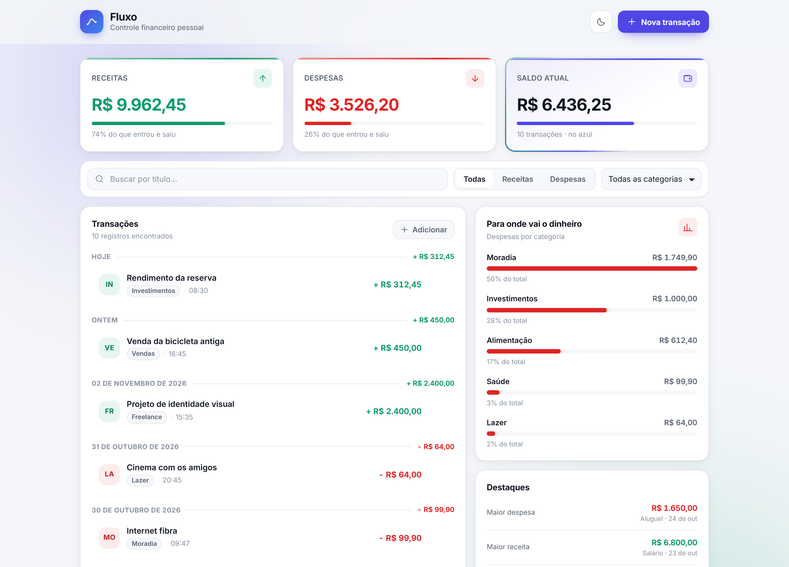
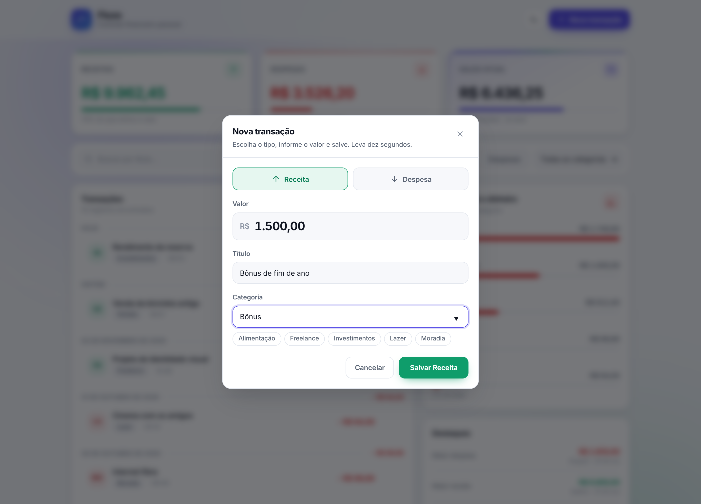

<div align="center">

# Fluxo

[](https://github.com/Th3usBit/fluxo-controle-financeiro/actions/workflows/ci.yml)
[](LICENSE)
[](CONTRIBUTING.md)

## Seu dinheiro, com toda a clareza.

Anote receitas e despesas em segundos e acompanhe o seu saldo crescer.<br>
**Simples, bonito e 100% seu.**

### [**✨ Abrir o Fluxo, é grátis**](https://th3usbit.github.io/fluxo-controle-financeiro/)

<sub>Funciona direto no navegador. Sem cadastro, sem instalar nada.</sub>

</div>

<br>



---

## Organizar as finanças pode ser leve

Saber para onde vai cada real é a base de toda conquista: a viagem, a reserva de emergência, o primeiro investimento. O Fluxo transforma isso num hábito rápido e gostoso: **você anota, ele organiza e mostra o seu progresso.**

Em poucos dias você já enxerga o seu mês inteiro. Em poucas semanas, decide com segurança onde guardar mais.

---

## Tudo o que você precisa, em uma tela

### 💰 Saiba exatamente quanto sobra
Receitas, despesas e saldo no topo da tela, sempre atualizados. Um olhar e você sabe que está no azul.

### ⚡ Lançou, pronto
Escolha receita ou despesa, digite o valor e salve. **Dez segundos**, com sugestão das categorias que você já usa e o valor escrito do seu jeito: `1.250,50`.

### 🎉 Comemore cada conquista
Entrou dinheiro? O cartão de receitas e o saldo brilham em verde, mostram quanto subiu e a nova entrada chega com destaque na lista. Cada passo para a frente fica visível.

### 📊 Entenda os seus hábitos
O painel **Para onde vai o dinheiro** organiza as suas categorias por peso, com o percentual de cada uma. Fica fácil ver quanto você já está guardando em investimentos e onde dá para render mais.

### 🔍 Encontre qualquer coisa num instante
Busque pelo nome, veja só receitas ou só despesas, filtre por categoria. **Os totais acompanham o filtro**, então "quanto entrou de freela este mês?" tem resposta na hora.

### 🌗 Lindo de dia e de noite
Tema claro e tema escuro, no computador ou no celular. Abra onde for mais confortável.

<table>
  <tr>
    <td width="50%"></td>
    <td width="50%"></td>
  </tr>
  <tr>
    <td align="center"><b>Seu mês inteiro em um olhar</b></td>
    <td align="center"><b>Também no tema escuro</b></td>
  </tr>
</table>

<p align="center">
  <br>
  <b>Uma nova receita em dez segundos</b>
</p>

---

## Privacidade de verdade

O Fluxo foi feito para que as suas finanças continuem sendo só suas.

- 🔒 **Tudo fica no seu navegador.** Nada vai para servidor, nada passa por terceiros.
- 🙌 **Sem conta e sem login.** Você abre e já está usando.
- 🌱 **Sem anúncios e sem venda de dados.**
- 🧾 **Código aberto.** Qualquer pessoa pode conferir cada linha do que o Fluxo faz.

> **Dica:** como os dados moram no navegador, use sempre o mesmo aparelho e o mesmo navegador. Assim o seu histórico fica completo.

---

## Comece hoje, em três passos

1. **[Abra o Fluxo](https://th3usbit.github.io/fluxo-controle-financeiro/).** Ele já está pronto para usar.
2. **Explore o mês de exemplo** e veja como tudo funciona na prática.
3. **Apague os exemplos e lance a sua primeira receita.** Pronto: o seu controle financeiro começou.

---

## Perguntas frequentes

<details>
<summary><b>Quanto custa?</b></summary>
<br>
Nada. O Fluxo é gratuito e de código aberto, sob a licença MIT.
</details>

<details>
<summary><b>Preciso criar uma conta?</b></summary>
<br>
Não. É só abrir o site e começar.
</details>

<details>
<summary><b>Meus dados ficam seguros?</b></summary>
<br>
Sim. Eles ficam guardados no seu próprio navegador e não passam por nenhum servidor.
</details>

<details>
<summary><b>Funciona no celular?</b></summary>
<br>
Funciona, direto no navegador, com a tela pensada para o celular.
</details>

<details>
<summary><b>Posso usar em mais de um aparelho?</b></summary>
<br>
Pode abrir em qualquer aparelho. Cada um guarda a própria lista, então o ideal é escolher um aparelho principal para o seu controle.
</details>

<details>
<summary><b>Por que eu mesmo lanço os valores?</b></summary>
<br>
Porque é o jeito mais eficaz de criar consciência financeira: anotar leva segundos e faz você notar cada movimento do seu dinheiro.
</details>

<details>
<summary><b>Como começo do zero?</b></summary>
<br>
Exclua as transações de exemplo pela lixeira de cada linha e lance as suas. O Fluxo guarda tudo automaticamente.
</details>

<br>

<div align="center">

### O seu mês mais organizado começa agora.

### [**✨ Abrir o Fluxo**](https://th3usbit.github.io/fluxo-controle-financeiro/)

<sub>Grátis · sem cadastro · seus dados ficam com você</sub>

</div>

---


## Por dentro do Fluxo

**Quer rodar na sua máquina, estudar o código ou deixar o Fluxo melhor?** Você está no lugar certo. O projeto é TypeScript estrito de ponta a ponta, tem testes na API e na interface e passa pela CI em cada pull request. Em cinco minutos ele está rodando aí.

O Fluxo tem duas formas de rodar:

- **Completa:** uma API em Node.js guarda os dados em um banco SQLite, e a interface conversa com ela pela rede. É o modo de desenvolvimento.
- **Só no navegador:** a mesma interface, sem servidor, com os dados no `localStorage`. É a versão publicada no GitHub Pages.

### Ferramentas e tecnologias

**Linguagem e ambiente**
- [TypeScript](https://www.typescriptlang.org): linguagem de todo o código, em modo estrito
- [Node.js](https://nodejs.org) 22 e npm: rodam a API, os testes e as ferramentas

**Interface**
- [Next.js](https://nextjs.org): páginas e site estático do GitHub Pages
- [React](https://react.dev): componentes da tela
- CSS Modules: estilos e tema claro/escuro

**API e dados**
- [Express](https://expressjs.com): recebe os pedidos
- [SQLite](https://sqlite.org), via [better-sqlite3](https://github.com/WiseLibs/better-sqlite3): guarda os dados num arquivo
- [Zod](https://zod.dev): valida o que chega, com mensagens em português

**Testes e qualidade**
- [Vitest](https://vitest.dev), [Testing Library](https://testing-library.com) e [Supertest](https://github.com/ladjs/supertest): testes da interface e da API
- [ESLint](https://eslint.org): padrão do código

**Automação**
- GitHub Actions: CI em todo pull request e publicação do site
- Dependabot: atualização mensal das dependências

### Como a aplicação funciona

Do clique em **Salvar** até o número mudar na tela, o caminho é este:


Passo a passo de um lançamento:

1. Você preenche o formulário. A interface confere os campos antes de enviar: título, valor maior que zero e categoria.
2. O pedido vai para a API (`POST /transactions`) ou, na versão publicada, para o `api-local.ts`.
3. A API valida tudo de novo com o Zod. O **tipo** escolhido (receita ou despesa) decide o sinal do valor, então uma despesa sempre é gravada como valor negativo.
4. O repositório grava a transação no SQLite, ou na memória se `STORAGE=memoria`.
5. A tela pede de novo, **ao mesmo tempo**, a lista, o resumo e as categorias, com os filtros ativos. Por isso os totais do topo sempre batem com a lista.
6. O `calcularResumo` soma receitas e despesas, calcula o saldo e agrupa por categoria, arredondando em centavos.

### Rodando em cinco minutos

**1. Pré-requisitos:** [Git](https://git-scm.com), e [Node.js](https://nodejs.org) 22 com npm. Quem usa o [nvm](https://github.com/nvm-sh/nvm) pode rodar `nvm use` na pasta do projeto, que lê o `.nvmrc`.

```bash
node --version   # v22.x (mínimo v18)
npm --version
```

**2. Baixe o projeto e instale as dependências**

```bash
git clone https://github.com/Th3usBit/fluxo-controle-financeiro.git
cd fluxo-controle-financeiro
npm run instalar        # instala server/ e web/ de uma vez
```

**3. Configure a API (opcional).** Tudo funciona com os valores padrão. Para mudar algo, copie o modelo:

```bash
cp server/.env.example server/.env
```

| Variável | Padrão | O que faz |
| --- | --- | --- |
| `PORT` | `3333` | Porta da API |
| `CORS_ORIGIN` | `http://localhost:3000` | Endereços que podem chamar a API, separados por vírgula |
| `STORAGE` | `sqlite` | `sqlite` grava em arquivo; `memoria` perde tudo ao desligar |
| `DATABASE_FILE` | `data/fluxo.db` | Arquivo do banco, criado sozinho na primeira execução |
| `SEED` | `true` | `false` impede de criar as transações de exemplo no banco vazio |

A interface aceita duas variáveis: `NEXT_PUBLIC_API_URL`, o endereço da API (padrão `http://localhost:3333`), e `NEXT_PUBLIC_MODO=local`, que liga o modo só no navegador.

**4. Suba a aplicação**, cada parte em um terminal:

```bash
npm run dev:api     # API em http://localhost:3333
```

```bash
npm run dev:web     # interface em http://localhost:3000
```

Abra <http://localhost:3000> e pronto. Na primeira execução, a API cria o banco sozinha e cadastra 10 transações de exemplo, então você já vê tudo funcionando.

Para rodar **só a interface**, como no GitHub Pages:

```bash
cd web
NEXT_PUBLIC_MODO=local npm run dev
```

> No Windows (PowerShell), defina a variável antes: `$env:NEXT_PUBLIC_MODO="local"; npm run dev`.

### Todos os comandos

Na raiz do projeto:

| Comando | O que faz |
| --- | --- |
| `npm run instalar` | Instala as dependências da API e da interface |
| `npm run dev:api` | Sobe a API em modo desenvolvimento |
| `npm run dev:web` | Sobe a interface em modo desenvolvimento |
| `npm test` | Roda os testes das duas partes |
| `npm run typecheck` | Confere os tipos das duas partes |

Dentro de `server/` (API):

| Comando | O que faz |
| --- | --- |
| `npm run dev` | Sobe a API e reinicia a cada mudança no código |
| `npm run build` | Compila o TypeScript para `dist/` |
| `npm start` | Roda a versão compilada (depois do `build`) |
| `npm test` | Testes de rotas, validação e cálculo do saldo |
| `npm run test:watch` | Testes em modo contínuo |
| `npm run typecheck` | Confere os tipos sem gerar arquivos |

Dentro de `web/` (interface):

| Comando | O que faz |
| --- | --- |
| `npm run dev` | Sobe a interface em modo desenvolvimento |
| `npm run build` | Gera a versão de produção |
| `npm start` | Serve a versão de produção (depois do `build`) |
| `npm run lint` | Confere o padrão do código com o ESLint |
| `npm test` | Testes do formulário, da formatação e do modo local |
| `npm run test:watch` | Testes em modo contínuo |
| `npm run typecheck` | Confere os tipos sem gerar arquivos |

Para gerar o site estático, o mesmo que vai para o GitHub Pages, na pasta `web/out`:

```bash
cd web
NEXT_PUBLIC_MODO=local npm run build
```

### Estrutura de pastas

```
fluxo-controle-financeiro/
├── server/                 API
│   ├── src/
│   │   ├── server.ts       ponto de entrada: escolhe o armazenamento e sobe o servidor
│   │   ├── app.ts          monta o Express (CORS, JSON, rotas, erros)
│   │   ├── routes/         endereços da API
│   │   ├── controllers/    recebe o pedido, valida e responde
│   │   ├── schemas/        regras de validação (Zod)
│   │   ├── repositories/   acesso aos dados: SQLite e memória
│   │   ├── shared/         cálculo do resumo e erros da aplicação
│   │   ├── middlewares/    log, rota não encontrada e tratamento de erros
│   │   └── database/       conexão, criação da tabela e dados de exemplo
│   └── tests/
├── web/                    interface
│   ├── src/
│   │   ├── app/            página, layout e estilos globais (tema)
│   │   ├── components/     cartões, filtros, lista, gráfico, formulário, modal
│   │   ├── hooks/          estado das transações, tema e animação dos números
│   │   ├── services/       api.ts (HTTP) e api-local.ts (navegador)
│   │   └── utils/          formatação de dinheiro e datas em pt-BR
│   └── tests/
└── .github/                CI, publicação, Dependabot e modelos de issue e PR
```

---

## Faça parte

O Fluxo é aberto, e **toda contribuição conta**: corrigir um erro de digitação, sugerir uma ideia ou escrever uma funcionalidade inteira.

- 🐛 **Achou um problema ou teve uma ideia?** [Abra uma issue](https://github.com/Th3usBit/fluxo-controle-financeiro/issues/new/choose). Leva um minuto e já ajuda.
- 🛠️ **Quer escrever código?** O [guia de contribuição](CONTRIBUTING.md) mostra como o projeto está organizado e o que a CI confere. Você não começa no escuro.
- 🤝 **Aqui todo mundo é bem-vindo.** Quem participa segue o [código de conduta](CODE_OF_CONDUCT.md).
- 🔐 **Encontrou uma falha de segurança?** Relate em privado, como descrito na [política de segurança](SECURITY.md).

Gostou do projeto? **Deixe uma ⭐ no repositório.** É de graça e ajuda o Fluxo a chegar em mais gente.

## Licença

[MIT](LICENSE): use, modifique e distribua à vontade, inclusive em projetos comerciais.
