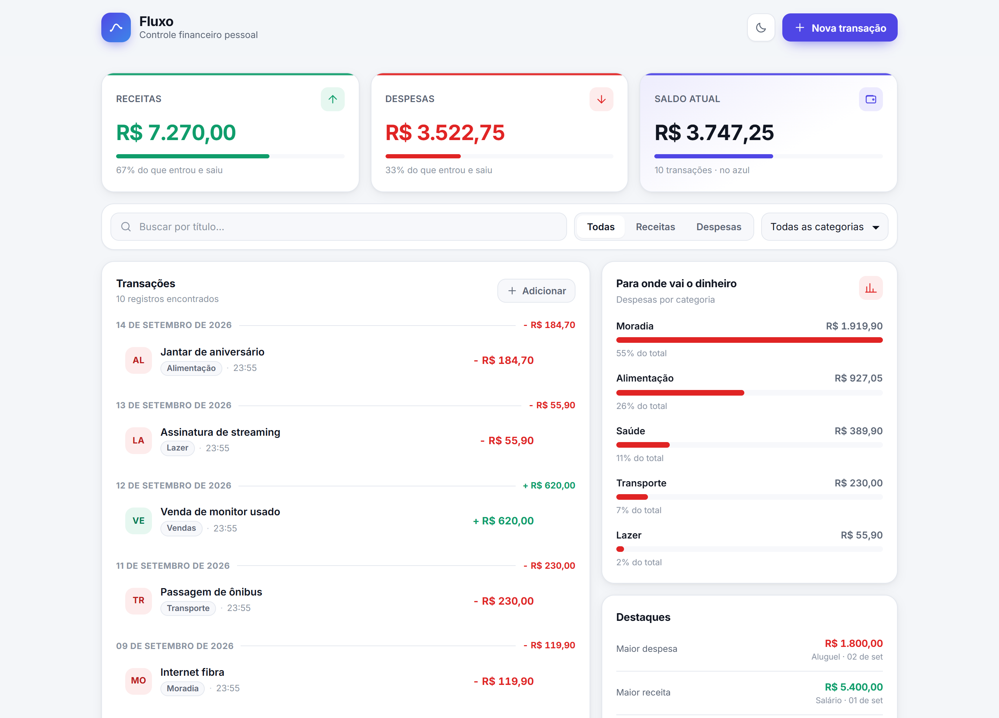
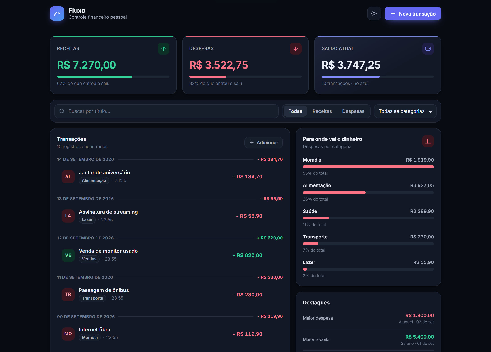
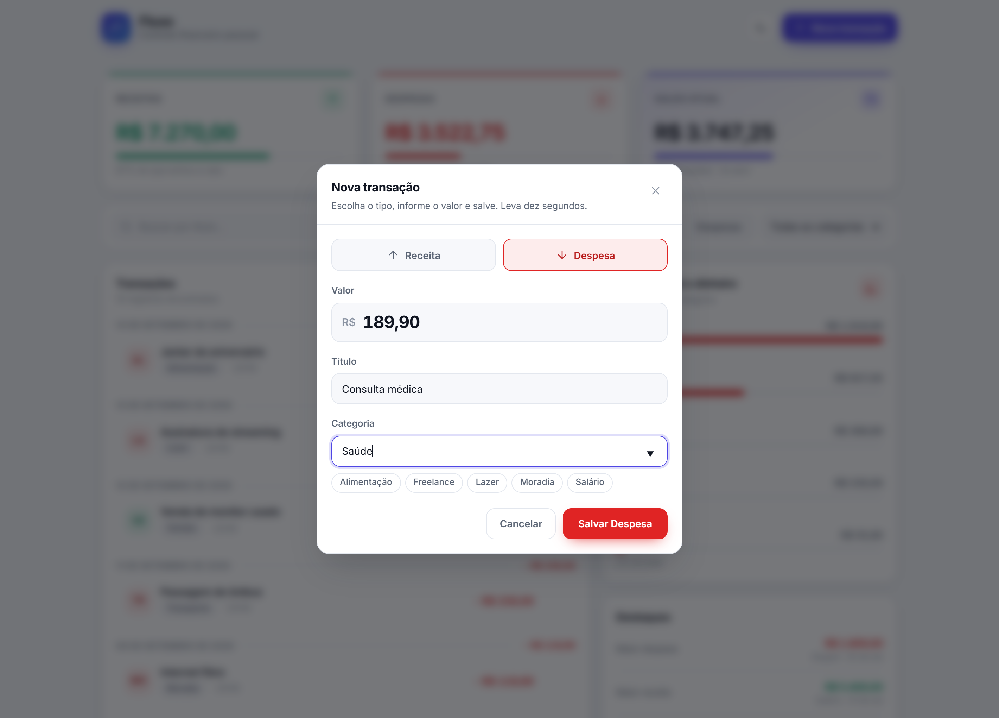
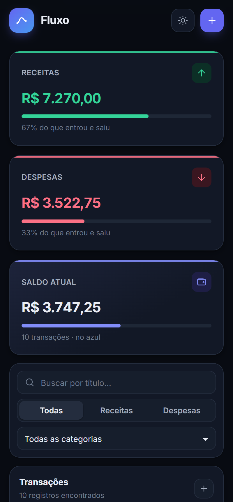

# Fluxo

Controle financeiro pessoal: registre receitas e despesas, acompanhe o saldo e veja para onde o dinheiro está indo.

Sem login, sem configuração extra. `npm install`, `npm run dev` nas duas pastas e está no ar.



<details>
<summary>Mais telas (tema escuro, formulário e celular)</summary>

<br>

| Tema escuro | Nova transação |
| --- | --- |
|  |  |



</details>

---

## Como rodar

**Pré-requisitos:** Node.js 18+ e npm.

Abra dois terminais — um para a API, outro para a interface.

```bash
# Back-end (porta 3333)
cd server
npm install
npm run dev
```

```bash
# Front-end (porta 3000)
cd web
npm install
npm run dev
```

Pronto: abra <http://localhost:3000>.

> Se preferir, a raiz tem atalhos: `npm run instalar` instala as duas pastas de uma vez, e `npm run dev:api` / `npm run dev:web` sobem cada parte sem precisar trocar de diretório.

Na primeira execução o banco nasce vazio e a API cadastra **10 transações de exemplo**, para a tela não abrir em branco. Para desligar isso, rode a API com `SEED=false`.

### Rodando os testes

```bash
cd server && npm test   # 18 testes: API, validação e regra de saldo
cd web    && npm test   # 16 testes: formulário e formatação
```

Outros comandos úteis nas duas pastas: `npm run typecheck` e, no front, `npm run lint` e `npm run build`.

---

## A API

Base: `http://localhost:3333`

| Método | Rota | O que faz |
| --- | --- | --- |
| `GET` | `/transactions` | Lista as transações, da mais recente para a mais antiga |
| `POST` | `/transactions` | Cria uma transação |
| `DELETE` | `/transactions/:id` | Remove uma transação |
| `GET` | `/summary` | Receitas, despesas, saldo e quebra por categoria |
| `GET` | `/categories` | Categorias já cadastradas (alimenta o filtro da interface) |
| `GET` | `/health` | Verificação rápida de que a API está de pé |

### A transação

```json
{
  "id": "0f6c1c8e-6d0e-4a0b-9a0f-1d9f0b2a5c31",
  "title": "Salário",
  "amount": 5400,
  "category": "Salário",
  "createdAt": "2026-09-15T12:00:00.000Z"
}
```

`amount` positivo é receita, negativo é despesa. `id` e `createdAt` são gerados pelo back-end — o cliente não envia nem consegue sobrescrever.

### Criando

```bash
curl -X POST http://localhost:3333/transactions \
  -H "Content-Type: application/json" \
  -d '{"title":"Mercado do mês","amount":-742.35,"category":"Alimentação"}'
```

O campo opcional `type` (`"receita"` ou `"despesa"`) manda no sinal do valor. É o que a interface usa: ela envia o valor sempre positivo e o tipo escolhido no formulário, e o back-end grava `-742.35`. Isso evita o erro clássico de cadastrar despesa com valor positivo.

```bash
curl -X POST http://localhost:3333/transactions \
  -H "Content-Type: application/json" \
  -d '{"title":"Mercado do mês","amount":742.35,"category":"Alimentação","type":"despesa"}'
```

### Filtros

`GET /transactions` e `GET /summary` aceitam os mesmos parâmetros, então os totais na tela sempre batem com a lista logo abaixo:

| Parâmetro | Valores | Exemplo |
| --- | --- | --- |
| `type` | `receita`, `despesa`, `todas` | `/transactions?type=despesa` |
| `category` | texto livre (ignora acento e caixa) | `/summary?category=alimentacao` |
| `search` | busca no título | `/transactions?search=mercado` |

### Quando algo dá errado

Todo erro volta no mesmo formato, com mensagem em português e o detalhe por campo:

```json
{
  "erro": {
    "mensagem": "Não foi possível criar a transação. Confira os campos informados.",
    "detalhes": [
      { "campo": "title", "mensagem": "O título precisa ter pelo menos 2 caracteres." },
      { "campo": "amount", "mensagem": "O valor precisa ser diferente de zero." }
    ]
  }
}
```

| Situação | Status |
| --- | --- |
| Campo faltando, inválido ou desconhecido | `400` |
| JSON malformado no corpo | `400` |
| `DELETE` em id que não existe | `404` |
| Rota que não existe | `404` |
| Falha inesperada | `500` |

O front mostra esses erros no campo correspondente do formulário e, quando a API está fora do ar, troca a lista por um aviso com botão de tentar de novo.

---

## Estrutura

```
fluxo/
├── server/                      # API - Node + Express + TypeScript
│   ├── src/
│   │   ├── server.ts            # sobe o servidor e escolhe o armazenamento
│   │   ├── app.ts               # monta o Express (recebe o repositório por parâmetro)
│   │   ├── routes/              # desenho das rotas
│   │   ├── controllers/         # entrada HTTP: valida, chama o repositório, responde
│   │   ├── repositories/        # acesso a dados: interface + SQLite + memória
│   │   ├── schemas/             # validação com Zod, em português
│   │   ├── shared/              # erros da aplicação e cálculo do resumo
│   │   ├── middlewares/         # log, 404 e tratamento central de erros
│   │   ├── database/            # conexão SQLite, migração e dados de exemplo
│   │   └── types/               # tipos do domínio
│   └── tests/                   # Vitest + Supertest
│
├── web/                         # Interface - Next.js (App Router) + React + TypeScript
│   ├── src/
│   │   ├── app/                 # layout, página e design tokens
│   │   ├── components/          # cabeçalho, cartões, gráfico, lista, modal, formulário
│   │   ├── hooks/               # estado das transações, tema e animação dos totais
│   │   ├── services/            # cliente da API
│   │   ├── types/               # espelho tipado do contrato
│   │   └── utils/               # formatação de dinheiro e datas em pt-BR
│   └── tests/                   # Vitest + Testing Library
│
└── docs/                        # capturas usadas neste README
```

---

## Decisões

**Camada de repositório.** Os controllers dependem de uma interface (`RepositorioDeTransacoes`), não do banco. Existem duas implementações: SQLite, usada quando a API sobe, e memória, usada nos testes — que por isso rodam rápido e sem tocar em arquivo nenhum. Trocar por Postgres amanhã é escrever uma terceira implementação, sem mexer nas rotas.

**SQLite de verdade, mas sem setup.** `better-sqlite3` instala com binário pronto (não precisa de compilador) e o arquivo `server/data/fluxo.db` é criado junto com a tabela na primeira execução. Quem preferir rodar sem tocar no disco usa `STORAGE=memoria`.

**Validação no Zod, com mensagem que dá para mostrar na tela.** O schema aceita valor em número ou texto (`"1250,50"` funciona), recusa zero, limita a duas casas decimais, corta espaços de título e categoria e rejeita campo desconhecido — `{ "titulo": ... }` em vez de `{ "title": ... }` vira um erro explicando o que enviar.

**Saldo calculado em função pura.** `calcularResumo` não conhece HTTP nem banco: recebe uma lista e devolve os totais. É onde mora a regra de negócio e é o que os testes cobrem com mais cuidado, inclusive o arredondamento (`0.1 + 0.2` não pode virar `0.30000000000000004` em cima de dinheiro).

**Express 5.** Promise rejeitada dentro de um handler assíncrono cai sozinha no tratador central de erros, sem precisar embrulhar cada rota num `try/catch`.

**TypeScript estrito nos dois lados.** `strict` e `noUncheckedIndexedAccess` ligados, sem nenhum `any` no projeto. O front tem o contrato da API tipado em `types/transacao.ts`, e o erro da API é uma classe (`ErroDaApi`) que carrega status e detalhes por campo.

**CSS Modules com design tokens, sem framework de UI.** Cor, raio, sombra e espaçamento vivem em variáveis no `globals.css`; o tema escuro é uma redefinição dessas variáveis. Nenhuma dependência de estilo, e o que aparece na tela é CSS que dá para ler.

**Idioma.** Interface, mensagens de erro, comentários e nomes de variáveis em português. Os campos do contrato HTTP (`title`, `amount`, `category`, `createdAt`) ficaram em inglês porque são o contrato pedido, e misturar os dois idiomas dentro do mesmo JSON seria pior. A única exceção no código são os hooks do React, que precisam do prefixo `use` — é exigência do próprio React e do ESLint, não escolha de estilo.

---

## O que tem além do pedido

- **Filtros combinados** por tipo, categoria e busca por título, aplicados também no resumo — os cartões acompanham o que está filtrado.
- **Persistência em SQLite**, com índices e migração automática.
- **34 testes** (18 na API, 16 no front), incluindo teste de componente do formulário.
- **Gráfico de despesas por categoria**, com as menores agrupadas em "Outras".
- **Painel de destaques**: maior despesa, maior receita, categoria que mais pesa e gasto médio.
- **Tema claro e escuro**, seguindo a preferência do sistema e guardando a escolha, sem piscar branco no carregamento.
- **Interface responsiva**, de 360px até telas largas.
- **Acessibilidade**: foco visível, navegação por teclado no modal (Esc fecha, Tab não escapa), rótulos em todos os campos e `aria-live` nos avisos.
- **Estados de verdade**: carregando (esqueleto), vazio, vazio-por-filtro, erro de API e confirmação antes de excluir.

## Variáveis de ambiente

Nenhuma é obrigatória. Os padrões já fazem o projeto rodar.

**`server`** (veja `server/.env.example`)

| Variável | Padrão | Para quê |
| --- | --- | --- |
| `PORT` | `3333` | Porta da API |
| `CORS_ORIGIN` | `http://localhost:3000` | Origens liberadas, separadas por vírgula |
| `STORAGE` | `sqlite` | `sqlite` grava em disco, `memoria` mantém em um array |
| `DATABASE_FILE` | `data/fluxo.db` | Caminho do arquivo do banco |
| `SEED` | `true` | `false` não cria as transações de exemplo |

**`web`**

| Variável | Padrão | Para quê |
| --- | --- | --- |
| `NEXT_PUBLIC_API_URL` | `http://localhost:3333` | Endereço da API |
