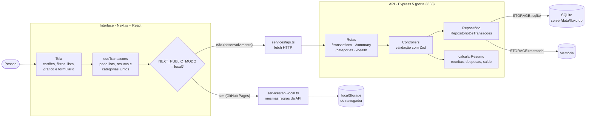

<div align="center">

# Fluxo

[](https://github.com/Th3usBit/fluxo-controle-financeiro/actions/workflows/ci.yml)
[](LICENSE)
[](CONTRIBUTING.md)

**Veja para onde vai o seu dinheiro.**

Registre receitas e despesas em segundos, acompanhe o saldo e descubra em quais categorias o mês está pesando.

[**Abrir o Fluxo →**](https://th3usbit.github.io/fluxo-controle-financeiro/)

Grátis · sem cadastro · funciona no computador e no celular

</div>

<br>


---

## O que dá para fazer

**Saber quanto sobrou, de relance.** Receitas, despesas e saldo ficam no topo da tela, junto com a fatia de cada um no que entrou e saiu.

**Lançar um gasto em dez segundos.** Escolha se é receita ou despesa, digite o valor e o título e salve. As categorias que você já usou aparecem como sugestão, então não precisa digitar tudo de novo.

**Descobrir onde o dinheiro está indo.** O painel *Para onde vai o dinheiro* ordena as categorias da maior para a menor despesa, com o percentual de cada uma. Os *Destaques* mostram qual foi a maior despesa e a maior receita.

**Encontrar qualquer lançamento.** Busque pelo título e filtre por receitas, despesas ou categoria. Os totais do topo acompanham o filtro, então é fácil saber, por exemplo, quanto foi só em alimentação.

**Usar como preferir.** Tem tema claro e tema escuro, e o layout se ajusta ao celular.

<table>
  <tr>
    <td width="50%"></td>
    <td width="50%"></td>
  </tr>
  <tr>
    <td align="center">Nova transação</td>
    <td align="center">Tema escuro</td>
  </tr>
</table>

---

## Seus dados ficam com você

Não tem conta nem login, e nada vai para um servidor: os lançamentos ficam salvos **no próprio navegador**. Isso tem duas consequências:

- Ninguém além de você vê os seus números.
- Os dados ficam só naquele navegador e naquele aparelho. Se você limpar os dados do site ou abrir em outro aparelho, a lista começa do zero.

Na primeira visita, o Fluxo abre com alguns lançamentos de exemplo para você explorar. Pode apagar todos e começar do seu jeito.

---

## Para quem quer rodar no próprio computador

O Fluxo tem duas formas de rodar:

- **Completa:** uma API em Node.js guarda os dados em um banco SQLite, e a interface conversa com ela pela rede. É o modo de desenvolvimento.
- **Só no navegador:** a mesma interface, sem servidor, com os dados no `localStorage`. É a versão publicada no GitHub Pages.

### Ferramentas e tecnologias

| Camada | Tecnologia | Versão | Para que serve |
| --- | --- | --- | --- |
| Linguagem | [TypeScript](https://www.typescriptlang.org) | 7 na API · 5 na interface | Todo o código, em modo estrito |
| Ambiente | [Node.js](https://nodejs.org) + npm | 22 (mínimo 18) | Roda a API, as ferramentas e os testes |
| **API** | [Express](https://expressjs.com) | 5.3 | Servidor HTTP e rotas |
| | [better-sqlite3](https://github.com/WiseLibs/better-sqlite3) | 13 | Banco SQLite em arquivo, sem instalar servidor de banco |
| | [Zod](https://zod.dev) | 4.6 | Validação dos dados recebidos, com mensagens em português |
| | [cors](https://github.com/expressjs/cors) | 2.8 | Libera a interface (porta 3000) para chamar a API (porta 3333) |
| | [tsx](https://tsx.is) | 4.23 | Roda o TypeScript direto em desenvolvimento, recarregando a cada mudança |
| **Interface** | [Next.js](https://nextjs.org) (App Router) | 16.4 | Estrutura da aplicação e build estático para o GitHub Pages |
| | [React](https://react.dev) | 19.3 | Componentes e estado da tela |
| | CSS Modules | nativo do Next | Estilos isolados por componente, com tema claro e escuro por variáveis CSS |
| **Testes** | [Vitest](https://vitest.dev) | 5.0 | Executor de testes nas duas partes |
| | [Supertest](https://github.com/ladjs/supertest) | 7.3 | Testa as rotas da API sem subir servidor |
| | [Testing Library](https://testing-library.com) + jsdom | 16 · 30 | Testa componentes como o usuário usa |
| **Qualidade** | [ESLint](https://eslint.org) + eslint-config-next | 9 · 16.4 | Padrões de código da interface |
| **Automação** | GitHub Actions | — | CI em todo pull request e publicação no GitHub Pages |
| | Dependabot | — | Atualizações mensais de dependências |

### Como a aplicação funciona



Passo a passo de um lançamento:

1. Você preenche o formulário. A interface confere os campos antes de enviar: título, valor maior que zero e categoria.
2. O pedido vai para a API (`POST /transactions`) ou, na versão publicada, para o `api-local.ts`.
3. A API valida tudo de novo com o Zod. O **tipo** escolhido (receita ou despesa) decide o sinal do valor, então uma despesa sempre é gravada como valor negativo.
4. O repositório grava a transação no SQLite, ou na memória se `STORAGE=memoria`.
5. A tela pede de novo, **ao mesmo tempo**, a lista, o resumo e as categorias, com os filtros ativos. Por isso os totais do topo sempre batem com a lista.
6. O `calcularResumo` soma receitas e despesas, calcula o saldo e agrupa por categoria, arredondando em centavos.

### Passo a passo

**1. Pré-requisitos:** [Git](https://git-scm.com), e [Node.js](https://nodejs.org) 22 com npm. Quem usa o [nvm](https://github.com/nvm-sh/nvm) pode rodar `nvm use` na pasta do projeto, que lê o `.nvmrc`.

```bash
node --version   # v22.x (mínimo v18)
npm --version
```

**2. Baixe o projeto e instale as dependências**

```bash
git clone https://github.com/Th3usBit/fluxo-controle-financeiro.git
cd fluxo-controle-financeiro
npm run instalar        # instala server/ e web/ de uma vez
```

**3. Configure a API (opcional).** Tudo funciona com os valores padrão. Para mudar algo, copie o modelo:

```bash
cp server/.env.example server/.env
```

| Variável | Padrão | O que faz |
| --- | --- | --- |
| `PORT` | `3333` | Porta da API |
| `CORS_ORIGIN` | `http://localhost:3000` | Endereços que podem chamar a API, separados por vírgula |
| `STORAGE` | `sqlite` | `sqlite` grava em arquivo; `memoria` perde tudo ao desligar |
| `DATABASE_FILE` | `data/fluxo.db` | Arquivo do banco, criado sozinho na primeira execução |
| `SEED` | `true` | `false` impede de criar as transações de exemplo no banco vazio |

A interface aceita duas variáveis: `NEXT_PUBLIC_API_URL`, o endereço da API (padrão `http://localhost:3333`), e `NEXT_PUBLIC_MODO=local`, que liga o modo só no navegador.

**4. Suba a aplicação**, cada parte em um terminal:

```bash
npm run dev:api     # API em http://localhost:3333
```

```bash
npm run dev:web     # interface em http://localhost:3000
```

Abra <http://localhost:3000>. Na primeira execução, a API cria o banco e cadastra 10 transações de exemplo.

Para rodar **só a interface**, como no GitHub Pages:

```bash
cd web
NEXT_PUBLIC_MODO=local npm run dev
```

> No Windows (PowerShell), defina a variável antes: `$env:NEXT_PUBLIC_MODO="local"; npm run dev`.

### Todos os comandos

Na raiz do projeto:

| Comando | O que faz |
| --- | --- |
| `npm run instalar` | Instala as dependências da API e da interface |
| `npm run dev:api` | Sobe a API em modo desenvolvimento |
| `npm run dev:web` | Sobe a interface em modo desenvolvimento |
| `npm test` | Roda os testes das duas partes |
| `npm run typecheck` | Confere os tipos das duas partes |

Dentro de `server/` (API):

| Comando | O que faz |
| --- | --- |
| `npm run dev` | Sobe a API e reinicia a cada mudança no código |
| `npm run build` | Compila o TypeScript para `dist/` |
| `npm start` | Roda a versão compilada (depois do `build`) |
| `npm test` | Testes de rotas, validação e cálculo do saldo |
| `npm run test:watch` | Testes em modo contínuo |
| `npm run typecheck` | Confere os tipos sem gerar arquivos |

Dentro de `web/` (interface):

| Comando | O que faz |
| --- | --- |
| `npm run dev` | Sobe a interface em modo desenvolvimento |
| `npm run build` | Gera a versão de produção |
| `npm start` | Serve a versão de produção (depois do `build`) |
| `npm run lint` | Confere o padrão do código com o ESLint |
| `npm test` | Testes do formulário, da formatação e do modo local |
| `npm run test:watch` | Testes em modo contínuo |
| `npm run typecheck` | Confere os tipos sem gerar arquivos |

Para gerar o site estático, o mesmo que vai para o GitHub Pages, na pasta `web/out`:

```bash
cd web
NEXT_PUBLIC_MODO=local npm run build
```

### Estrutura de pastas

```
fluxo-controle-financeiro/
├── server/                 API
│   ├── src/
│   │   ├── server.ts       ponto de entrada: escolhe o armazenamento e sobe o servidor
│   │   ├── app.ts          monta o Express (CORS, JSON, rotas, erros)
│   │   ├── routes/         endereços da API
│   │   ├── controllers/    recebe o pedido, valida e responde
│   │   ├── schemas/        regras de validação (Zod)
│   │   ├── repositories/   acesso aos dados: SQLite e memória
│   │   ├── shared/         cálculo do resumo e erros da aplicação
│   │   ├── middlewares/    log, rota não encontrada e tratamento de erros
│   │   └── database/       conexão, criação da tabela e dados de exemplo
│   └── tests/
├── web/                    interface
│   ├── src/
│   │   ├── app/            página, layout e estilos globais (tema)
│   │   ├── components/     cartões, filtros, lista, gráfico, formulário, modal
│   │   ├── hooks/          estado das transações, tema e animação dos números
│   │   ├── services/       api.ts (HTTP) e api-local.ts (navegador)
│   │   └── utils/          formatação de dinheiro e datas em pt-BR
│   └── tests/
└── .github/                CI, publicação, Dependabot e modelos de issue e PR
```

---

## Contribuindo

Achou um problema ou tem uma ideia? [Abra uma issue](https://github.com/Th3usBit/fluxo-controle-financeiro/issues/new/choose). Para enviar código, o [guia de contribuição](CONTRIBUTING.md) explica como o projeto está organizado e o que a CI confere. Quem participa segue o [código de conduta](CODE_OF_CONDUCT.md), e falhas de segurança são relatadas em privado, como descrito na [política de segurança](SECURITY.md).

## Licença

[MIT](LICENSE). Use, modifique e distribua à vontade.
